# cg (circuit-graph analysis)

## Overview

Use the `cg` CLI from the **circuit-graph** project (`E:\__electric\__workspace\stacking\circuit-graph`) to analyze circuits instead of hand-parsing netlists. The CLI preserves 100% of the original IR — no information loss, no re-implementation of parsing.

Other projects can pull `cg` in via `uv pip install -e ".[dev]"` once the circuit-graph repo is on disk and reachable.

## Routing — pick the right command

```dot
digraph analyze {
    "Netlist path?" [shape=diamond];
    "Protel .NET" [shape=box];
    "KiCad .kicad_sch" [shape=box];
    "KiCad .net" [shape=box];
    "Only part number?" [shape=diamond];
    "cg view <id> <file>" [shape=box];
    "cg view ... --with-power" [shape=box];
    "cg view ... --with-comm" [shape=box];
    "cg export graph|graphml" [shape=box];
    "cg sim <id> <file>" [shape=box];
    "cg erc check <sch>" [shape=box];
    "cg kb import protel|kicad" [shape=box];
    "cg kb lookup|search|pinout" [shape=box];

    "Netlist path?" -> "Protel .NET" [label=".NET"];
    "Netlist path?" -> "KiCad .kicad_sch" [label=".kicad_sch"];
    "Netlist path?" -> "KiCad .net" [label=".net"];
    "Netlist path?" -> "Only part number?" [label="none"];
    "Protel .NET" -> "cg view <id> <file>" [label="what does X do"];
    "Protel .NET" -> "cg view ... --with-power" [label="power chain"];
    "Protel .NET" -> "cg view ... --with-comm" [label="comm bus"];
    "Protel .NET" -> "cg export graph|graphml" [label="full graph"];
    "Protel .NET" -> "cg sim <id> <file>" [label="simulation (PoC)"];
    "Protel .NET" -> "cg kb import protel" [label="ingest into KB"];
    "KiCad .kicad_sch" -> "cg erc check <sch>" [label="ERC check"];
    "KiCad .net" -> "cg kb import kicad" [label="ingest into KB"];
    "Only part number?" -> "cg kb lookup|search|pinout" [label="yes"];
}
```



## Core Commands (Protel .NET — the common case)

```powershell
# What does R100 do? (default 2-hop ego subgraph; --pretty for human reading)
cg view R100 <file.NET> [--hops N] [--pretty]

# Add power context: rail / source / upstream regulators
cg view U2 <file.NET> --with-power

# Add comm bus context: I2C / UART / SPI / PWM
cg view U2 <file.NET> --with-comm

# Both context layers
cg view U2 <file.NET> --with-all

# Full graph export (output/circuit.graph.json or .graphml)
cg export graph <file.NET>
cg export graphml <file.NET>
```

## Knowledge Base

```powershell
cg kb lookup <part_number>   # details + pins + pin_source
cg kb search <keyword>       # full-text
cg kb pinout <part_number>   # pin map only
cg kb import protel <file.NET>   # ingest netlist, auto-resolves IC pins
cg kb import kicad <file.net>   # KiCad netlist ingestion
cg kb stats
```

## ERC (KiCad `.kicad_sch` ONLY)

```powershell
cg erc check <file.kicad_sch>                       # native engine (4 validators)
cg erc check <file.kicad_sch> --engine kicad        # kicad-cli wrapper
cg erc check ... --format text --pretty             # human readable
cg erc check ... --severity error                   # filter
```

Exit codes: `1` if any ERROR, `0` otherwise — CI-friendly.

## Red Flags — Stop and Re-Route

- **Manually opening .NET in a text editor** to figure out what R100 does. `cg view <id> <file> --pretty` is the entry point; the IR is preserved 100% but reading raw text is slow and error-prone.
- **Running `cg erc` on a Protel `.NET` file** — unsupported format, will exit 2 with `unsupported schematic format: '.NET'`. Use `cg erc` only on `.kicad_sch`. For Protel, ingest via `cg kb import protel`.
- **Treating `cg sim` as if the designator matters** — Phase 1 PoC hardcodes an LM321 deck; the part-number you pass is **ignored**. Use it as an LM321 deck self-test, NOT as a simulation of the designator you passed.
- **Comparing IC `pins[].name` with passive `pins[].number` directly** — the KB only maintains pin names for ICs (e.g. U7's `{"number":1,"name":"IN+"}`). Passives (R/C/L/D) only have `number` + `net`, no `name`. Cross-reference IC pin **names → numbers**, never against passive numbers.
- **Power-context `--with-power` fallback means "not a bug"** — `source_kind: "unknown"` with `source_net_id: null` means the rail is internally generated or injected, NOT a power-tree tracing failure. Don't "fix" it; extend `_resolve_power_path` / `power_tree_recognizer` if you actually need that rail covered.

## Default Test Fixture

When the user doesn't specify a fixture, use:
`E:\__electric\__workspace\stacking\circuit-graph\fixtures\protel\FX-T268-V6-10米-5065.NET`

## Canonical Workflow — "R100 是什么"

```powershell
cg view R100 E:\__electric\__workspace\stacking\circuit-graph\fixtures\protel\FX-T268-V6-10米-5065.NET --pretty
```

If context is unclear (e.g. R100 sits on a regulator output and user wants to know why it's there), add `--with-power`. If R100 is on a bus and user asks about bus membership, add `--with-comm`.